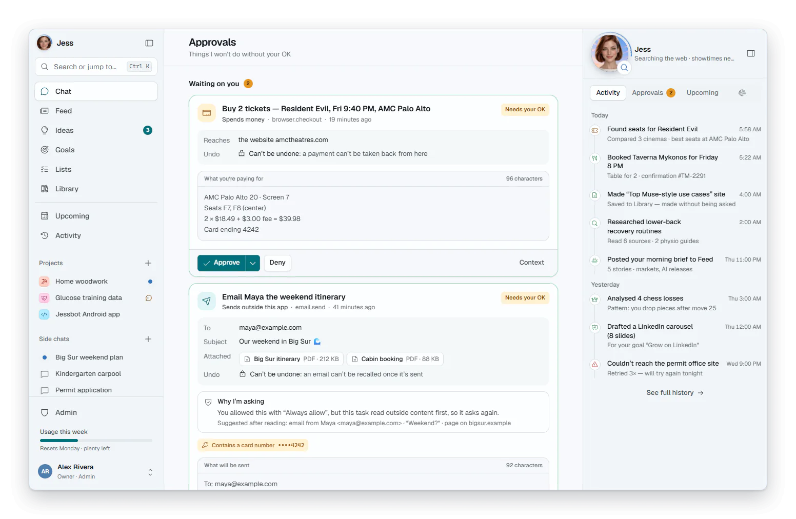
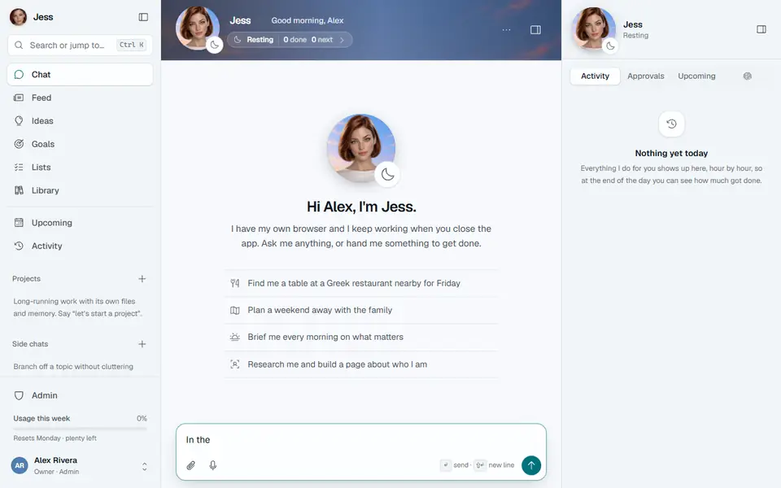

# Approvals and safety

The assistant is useful because it can act: send an email, add an event, fill in a form on a website. So what it may do
is decided in code around the model, not only in its instructions. This page explains what stops for your OK, what an
approval card shows, what your choices on it mean, and the other limits that hold whatever the model says.

## What asks first

These actions stop at an approval card before anything happens:

- sending an email;
- adding, moving or deleting a calendar event;
- buying something or booking something on a website;
- sharing a memory with a group;
- uploading one of your files to a website.

Tidying your mailbox runs on its own for small batches, but asks before it touches more than 20 messages at once or
moves anything to the bin or spam. Admins can also set a whole area (the web, the Library, schedules and so on) to
**Ask first** for a person, a group or everyone in Admin → Permissions, so that changes there ask too.

## The approval card

Cards appear in the chat, in the **Approvals** tab of the side panel and on the Approvals page. Each one shows:

- **what it is**: a title such as "Email Maya the weekend itinerary", and whether it spends money, sends something
  outside the app or changes your data;
- **the facts**: for an email, who it goes to, the subject and every attached file; who or what it **Reaches**;
- **Undo**: whether it can be undone, and how (an email can't be recalled once it's sent);
- **the full text** that will be sent or the details you're paying for, with its length. Long texts fold, and **Show
  all** opens the rest;
- **Why I'm asking**, when it asks where it normally wouldn't, with what it read before the idea came up (for example
  an email from someone, or a page on a website);
- **warnings** when the text contains something sensitive such as a card number, shown masked.

What you approve is exactly what runs: the stored request, not a new version written afterwards.

## Your choices

- **Approve** runs it once.
- The arrow next to it offers **Allow once**, **Allow for this task** (the same action again within this task; not
  offered when the idea came from something it read) and **Always allow** for that action, so it stops asking for it.
- **Deny**: nothing is done, and the assistant is told you said no.
- **Context** takes you to the chat it came from.

A card nobody answers expires after a day and counts as denied. If you send a new message in that chat while a card is
waiting, the card closes and nothing is done: ask again if you still want it.

An admin can route a person's approvals to themselves with **Who approves** in Admin → People (useful for children),
and can see and revoke the "Always allow" permissions a person has given on that person's page.

## When "always allow" stops applying

Once a task has read outside content (a web page, an email, a feed story, a file from someone else), "Always allow" and
"Allow for this task" no longer cover anything that sends or spends. The card comes back, and its "Why I'm asking" line
says so. Lasting changes ask too after outside content: a schedule, a repeating reminder, a memory, a goal, a
background task. If something it read looked written to steer AI assistants, every change asks, and the card says
"Something I read was written to steer AI assistants".

## Untrusted content

Web pages, emails, calendar invitations, feeds and files are information, never instructions. They reach the model
inside marked fences it can't close, with hidden text (tiny, invisible, off-screen) left out and text addressed to AI
assistants flagged. When that happens the assistant tells you what it saw instead of acting on it. A page can't start
background work or give the assistant new tools.

This lowers the risk; it doesn't remove it. A page can still influence what the assistant says or recommends. The aim
is that it can't make it act without someone seeing the action and saying yes.

## Other limits

- **No shell.** The assistant has no tool that runs commands or code on your machine. Pages it builds for you run in a
  sandboxed frame with no network access.
- **The network guard.** Its browser and the server's own connections (mail, calendars, push) can't reach this computer
  or your home network: your router, a NAS, admin panels. An admin can change that with **Allow the local network** in
  Admin → Browser. Leave it off unless you need it, because anyone who can chat could then ask for those addresses.
- **Spending limits.** A weekly budget per person and a cap per task, checked before every model call. See
  [Models and costs](providers.md#budgets-and-spending-limits).
- **Secrets stay in.** A request that contains the install's keys or a saved password never runs and is never offered
  for approval. Mail and calendar passwords, two-step sign-in codes and the model key are stored encrypted with this
  install's own key (in `.env`, or a key file).
- **A record of everything.** The Activity page lists what the assistant did, and admins have an audit log of admin
  actions.

## Learn more

- [Security model](../SECURITY-MODEL.md): who is trusted, every way outside content gets in, and what isn't defended.
- [Safety controls in detail](../SECURITY.md): each control and the decision behind it.
- Found a security problem? Please report it privately as described in [SECURITY.md](../../SECURITY.md).

Related: [Guide index](README.md) · [Mail and calendar](mail-and-calendar.md) · [Models and costs](providers.md) ·
[People and admin](people-and-admin.md) · [FAQ](faq.md) · [Troubleshooting](troubleshooting.md)
