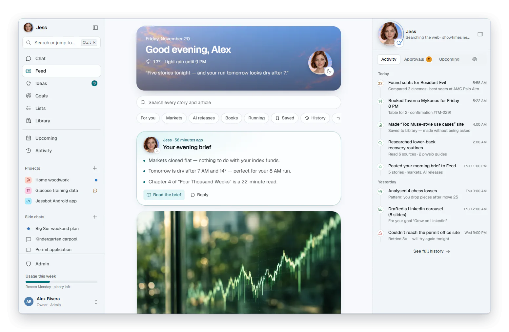
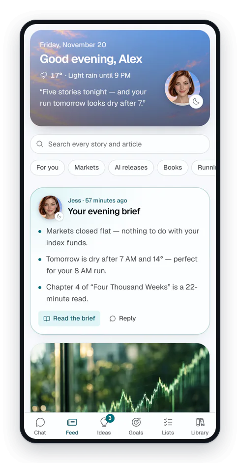

# Your Feed

The Feed is a page of stories the assistant finds and writes for you, about the things you said you care about. You
describe what you want in plain words, it picks sources, reads the articles and writes short posts and a brief a few
times a day. What you like, skip and mute shapes what comes next. Each person has their own Feed.

The Feed reads the web, so it needs the agent's browser (installed during setup or in Admin → Browser).

## Telling it what you want

Press **Tune** (or **Tune my feed** on an empty Feed) and answer "What do you want to see?" in your own words. Be as
specific as you like, times of day included, for example: "Finance news in the morning, non-fiction book picks in the
evening, new AI releases daily." Press **Update my feed**.

The assistant turns that into topics. Each topic gets a Google News search in your language and for the country you
live in, and each site you named gets its own feed (or, if it has none, a news search limited to that site). The topics
then appear as chips at the top of the Feed, next to **For you**, **Saved** and **History**.

## Your sources

**Review your sources** (in the Tune dialog) opens **Your sources**: every topic with where its stories come from and
how many sources are not answering. There you can:

- add a site or a feed link to a topic, or remove any source;
- edit a topic's name, its search words and its time of day (**Morning**, **Midday**, **Evening** or **Any time**);
- pause a topic, delete it, or start a new one with **New topic**.

Your changes stay when you tune the Feed again: a source you removed isn't added back, and a paused topic stays paused.

### Bring your feeds (OPML)

Coming from Feedly, Inoreader, NetNewsWire or another feed reader? Export its list as OPML, then on Your sources use
**Choose an .opml file** (or **Paste it instead**) and **Import**. Each folder becomes a topic, unless you fill in **Put
them all in one topic**. Feeds already there are skipped, and a summary says what was added. Nothing is fetched until
the next check. **Export mine** saves your own topics and feeds as an OPML file.

## Briefs

The assistant looks for new stories on its own three times a day, at 07:00, 12:30 and 18:30 your time, except during
your quiet hours or when your weekly budget is used up. It also looks when you tune the Feed or press **Refresh**.

Each round writes the best new stories and a short brief from the assistant (for example "Your evening brief"): three
to five one-line takeaways across them. The latest brief sits at the top of For you for a day. **Read the brief**
opens it in full, and **Reply** starts a chat about it.

## Reading and reacting

Tap a story to open it in a reading sheet: the assistant's take first, then the full article, and **Open the
original** to go to the site. **Ask** starts a chat about the story.

Under each story:

- the heart means **More like this**, the thumbs-down **Less like this**;
- **Save** keeps it under Saved, and **Share** passes it on;
- the menu (⋮) offers **Ask** the assistant about it, **More about** its topic, **Not interested in** its topic and
  **Fewer from** its source, plus a line saying why the story is there (for example because you follow a topic).

After "Not interested" or "Fewer from", an **Undo** button appears for a moment. Likes, saves, what you open and how
long you read all shape what the next round picks.

## Muted words

On Your sources, **Muted words** keeps stories out of your Feed when a word or short phrase is in the title or summary:
spoilers, a team you can't stand, a topic you need a break from. It matches whole words in any language ("trump" never
hides "trumpet"), and you can mute up to 100. Topics and sources you muted from story cards are listed below it under
**Muted from story cards**, where you can unmute them.

## Your reading diet

Once a month, a **Your reading diet** card on For you shows what you actually read over the last 30 days: the topics
and sources, minutes read, stories saved, whether your reading was **Varied**, **Balanced** or **Narrow**, and one
suggestion, such as a topic you follow but never open. Close it with the cross and it stays hidden until next month.

## Saved, history and search

- **Saved** holds every story you bookmarked.
- **History** collects the stories you opened, liked or saved and the ones written for you, by day.
- The search box searches every story and saved article.

Admins see every source the household follows in Admin → Feed, with its health and followers, and can fetch or remove
one for everyone.

Related: [Guide index](README.md) · [Getting started](getting-started.md) · [Library](library.md) ·
[Models and costs](providers.md) · [FAQ](faq.md) · [Troubleshooting](troubleshooting.md)
