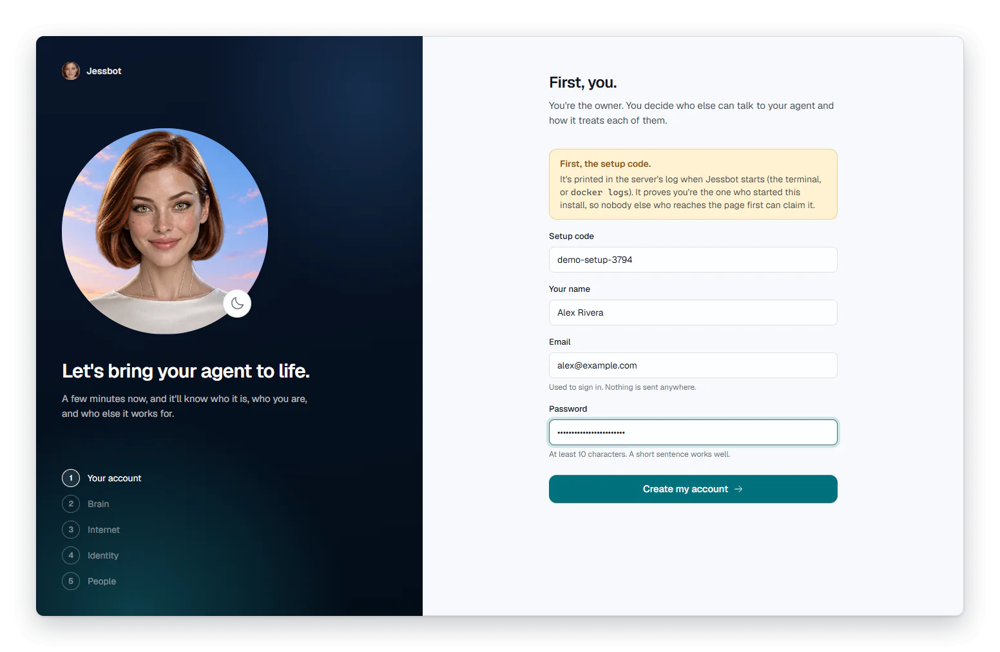

# Getting started

Jessbot is an AI assistant you run on your own computer or server for the people you live or work with. Each person gets
a private chat with it, and it keeps working in the background: it looks things up in its own browser, follows up on
reminders, writes a morning feed, and stops to ask before it sends, spends or books anything. This page takes you from
an empty folder to a running install with everyone invited.

Jessbot is an early preview. Run it at home or behind a VPN, not on the open internet.

## What you need

- **Node.js 24.19 or newer**, or **Docker** with Compose (Docker Desktop on Windows and macOS).
- **A key for an AI model.** [OpenRouter](https://openrouter.ai) is the default; any OpenAI-compatible service works too
  (see [Models and costs](providers.md)).
- **About 1 GB of disk**, plus about 200 MB for the agent's browser if Google Chrome isn't installed on the machine.

It runs on Windows and Linux. macOS should work, but nobody has tested it by hand yet.

## Install

With Docker, from the cloned folder:

```bash
docker compose up -d --build
```

With Node.js, from the cloned folder:

```bash
npm ci && npm run build && npm start
```

Then open http://127.0.0.1:3737. For the details of each system (the Docker image, a systemd service on Linux, starting
at sign-in on Windows, macOS, and a reverse proxy with HTTPS), see [Installing Jessbot](../INSTALL.md).

## Find the setup code

The first time Jessbot starts, it prints a **setup code** in its log, on a line like this:

```
[jessbot] setup code (asked when you create the admin account): 3F9A2-7C41B
```

With Node.js it's in the terminal where you ran `npm start`. With Docker, run
`docker compose logs jessbot | grep "setup code"`. The code proves you're the one who started this install, so nobody
else who reaches the page first can claim it. It changes each time the server restarts, until your account exists. To
choose your own, set `JESSBOT_SETUP_CODE` in `.env` (8 characters or more).

## The five setup steps

The setup page walks you through five steps. Your progress is saved, so a refresh or a restart picks up where you left
off.



1. **Your account.** The setup code, your name, your email (only used to sign in, nothing is sent to it) and a password
   of at least 10 characters. You become the owner and admin.
2. **Brain.** Your model key and the model to use. The default is `openai/gpt-6-luna`, a cheap, capable model. Under
   "Advanced: a different endpoint" you can point it at another service. Press **Test the connection**: Jessbot asks
   the model a real question, and **Continue** works once that succeeds. You can also choose **Skip for now** and add
   the key later in Admin → Models. The key stays on this machine, encrypted with the install's own key.
3. **Internet.** The agent reads the web through its own browser on this machine. If Chrome is installed, it uses that.
   Otherwise **Install browser** downloads open-source Chromium (about 200 MB) in the background while you carry on.
   Until a browser is there, chat, files, reminders, lists and mail work, but web lookups, the Feed and weather don't.
   The browser can't reach your home network unless you allow it later.
4. **Identity.** The assistant's name (Jess by default), a one-sentence description, its look, its pronouns and its
   tone. You can change all of this later: see [Name and look](name-and-look.md).
5. **People.** Make groups if you like (Family, Company, Friends) and create invite links for the others. Then press
   **Finish and meet your agent**.

## Inviting people

Each invite asks for a name, an optional email, a role (**Member** or **Admin**) and an optional group. **Create invite
link** gives you a link to send them yourself: it works once, expires in 7 days and is shown only once, so copy it
right away. The person opens it, picks their own password and joins.

You can invite people any time from Admin → People with the **Invite** button, where pending invites are listed and
can be revoked.

Invite links use `PUBLIC_URL` when it is set. Without it, a link uses the address you are on when you make it, so if
you set up on `127.0.0.1`, create invites from the address the others will actually use.

## Using it from your phone

By default Jessbot only answers on this computer (`127.0.0.1`). To reach it from other devices:

- **On your home network (Node.js installs):** set `HOST=0.0.0.0` in `.env` and restart, then open
  `http://<this computer's address>:3737` on your phone. Anyone on that network can reach the sign-in page.
- **Docker:** the port is published on this machine only. Reach it through a VPN (such as Tailscale or WireGuard) or a
  reverse proxy rather than publishing it on every interface.
- **Behind a reverse proxy with HTTPS:** set `PUBLIC_URL` to the address people use (for example
  `https://jessbot.example.com`). Invite links then use it, and Jessbot refuses requests for other host names. Add more
  names with `ALLOWED_HOSTS` if you need them. [Installing Jessbot](../INSTALL.md#behind-a-reverse-proxy) has a Caddy
  and nginx example.

The layout adapts to a phone screen, with the main sections in a bar at the bottom.

### Notifications

Alarms, reminders and messages the assistant starts on its own can reach your phone. Turn them on per device in
You → Notifications with **Turn on**, then **Send a test** to check. Notifications while Jessbot isn't open need HTTPS;
over plain HTTP they only arrive while the page is open. Using your phone's location for "Where you live" (You →
Places) needs HTTPS too.

Related: [Guide index](README.md) · [Models and costs](providers.md) · [Name and look](name-and-look.md) ·
[Approvals and safety](approvals-and-safety.md) · [People and admin](people-and-admin.md) ·
[Backups and updates](backups-and-updates.md) · [Troubleshooting](troubleshooting.md) · [FAQ](faq.md)
