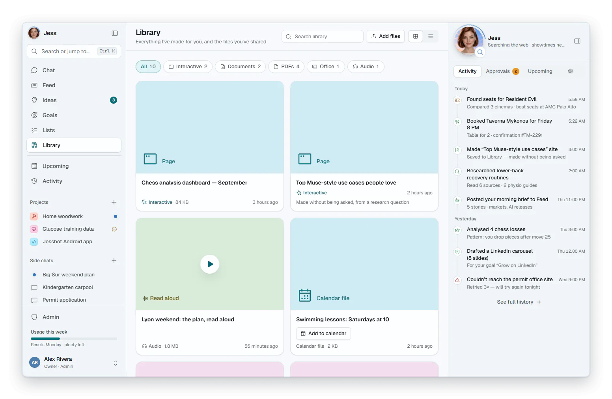
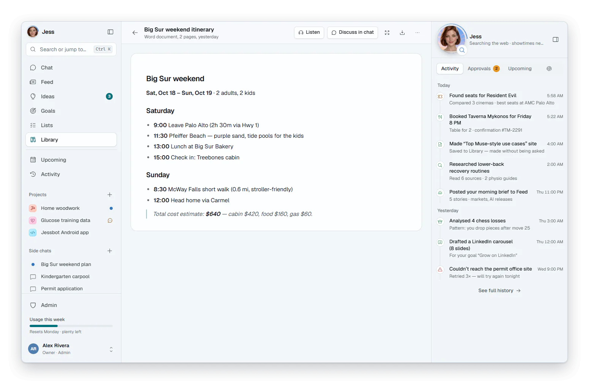

# The Library

Everything the assistant makes for you lands in your Library, and so does every file you give it: documents,
spreadsheets, slides, PDFs, pages, pictures, audio and calendar files. Each person has their own Library. This page
covers what you'll find there, how to look at and change things, and how to get files in and out.

## What lands here

You don't save anything by hand. When the assistant makes a file in a chat, a project or a background task, it goes
straight into the Library, and you can open it from the reply or from **Library** in the menu.

- **Word, Excel and PowerPoint files.** Real .docx, .xlsx and .pptx files that open in Office, LibreOffice or Google's
  apps. Spreadsheet formulas are worked out as the file is made, so the numbers are right wherever you open it.
- **PDFs.** PDFs it made, forms it filled in for you, and PDFs it merged into one. A filled form is saved as a new
  file, and your original stays as it was.
- **Pages.** Small interactive web pages: a trip plan, a dashboard, a quiz, a menu. They run in a sealed frame with no
  network access.
- **Pictures.** Pictures it made (invitations, colouring pages, story art), if the admin picked an image model in
  Admin → Models and turned on the Pictures permission for you. Both are off at first, and each picture costs a little.
- **Audio.** A document or story read aloud into one audio file.
- **Calendar files.** Events saved as an .ics file (a trip, fixtures, term dates) that your phone or calendar app adds
  in one tap.
- **Your own files.** Anything you drop into a chat, add from the Library, save from an email or download while the
  assistant browses for you.

Something the assistant made on its own initiative says **Made without being asked** on its card.

## Finding things

The chips at the top filter by kind: **All**, **Interactive** (pages), **Documents** (including Word files), **PDFs**,
**Images**, **Office** (spreadsheets and slides) and **Audio**. A chip only shows up once you have something of that
kind. The two buttons next to **Add files** switch between a grid and a list.

**Search library** matches titles straight away, then looks inside the files too, the same search the assistant uses
when you ask it to find something. To make a file easier to find, open it and choose **Edit title and description**
from the **More** menu (the three dots).

## Opening a file

Tap a card to open it. Documents show as text, spreadsheets and slides as previews, PDFs and pictures as themselves, and
pages run right there.

The bar at the top has:

- **Listen**: has the assistant read the file aloud into a new audio file. It tells you how long it will be first and
  only starts when you press **Record it**. It uses this week's voice budget, and spoken audio needs OpenRouter (see
  [Models and costs](providers.md)).
- **Discuss in chat**: starts a message about this file, so you can ask for changes or questions about it.
- **Open full screen** and **Download**.
- **More**: **Edit title and description**, **Where this came from** (the chat it was made in), the versions, and
  **Delete**. A deleted file can be brought back with **Undo** right after.

Calendar files have an **Add to calendar** button. Nothing is added to your calendar until you press it.

If LibreOffice is installed on the server, Word, Excel and PowerPoint files are previewed as they would print. Without
it, the preview is drawn from the file's content. It's optional either way.

### Scans and photos of paper

A PDF with no text in it (a scan) offers **Read this scan**, and a picture offers **Read the text in this picture**.
Nothing is read or spent until you agree: it first shows how many pages it would read and roughly what that costs, and
reads only after **Read it**. The text it finds is marked "Text from OCR (may contain errors)" and becomes searchable.

## Versions

When the assistant changes a file, it saves a new version instead of overwriting it. The header shows the version
number, and **More** lists every version with its date. Open an older one to look at it, or press **Restore** to make it
the current one again.

Your own files are never remade from scratch. Changing a few cells in your spreadsheet, or filling in or rewording your
Word document, keeps its formatting and saves the result as a new version you can undo with **Restore**. Anything
bigger, like a new document based on yours, becomes a new file next to it.

## Pages as PDF or PNG

Ask in chat to turn a page into a PDF or a picture, for example "make the party invitation an A5 PDF" or "a square PNG
of the chart for WhatsApp". It can export to A4, A5, Letter, square (1080×1080) or story (1080×1920), upright or
landscape. The export is a new Library item that says which page it was made from. Exporting needs the assistant's
browser, so it doesn't work until a browser is installed (see [Troubleshooting](troubleshooting.md)).

## Adding your own files

Press **Add files** in the Library, or drop files, photos or paste into the chat box. You can add up to 6 files at a
time, up to 25 MB each: PDFs, pictures (PNG, JPEG, WebP, GIF), Word, Excel and PowerPoint files, plain text, Markdown,
CSV and TSV, JSON, XML, YAML, calendar files, and .srt or .vtt transcripts. Jessbot checks what a file really is from
its contents, not its name. The assistant can then read your file, fill it in, or use it in something it makes.

## Who can see your Library

Your Library is yours. Other people in the household don't see it, and neither do admins, unless the admin has turned
on "Let admins read other people's chats". Then admins can open your files read-only, each look is logged, and you see
a notice on your You page saying so. See [People and admin](people-and-admin.md).

To share something, you can:

- **Download** it and send it however you like.
- Ask the assistant to email it. It can attach up to 5 of your Library files, and the approval card lists each one
  before anything is sent (see [Mail and calendar](mail-and-calendar.md)).
- Ask it to attach a file to a form on a website. That also asks first, naming the file and the site.

Related: [Guide index](README.md) · [Getting started](getting-started.md) · [Models and costs](providers.md) ·
[Approvals and safety](approvals-and-safety.md) · [Mail and calendar](mail-and-calendar.md) ·
[People and admin](people-and-admin.md) · [Troubleshooting](troubleshooting.md) · [FAQ](faq.md)
