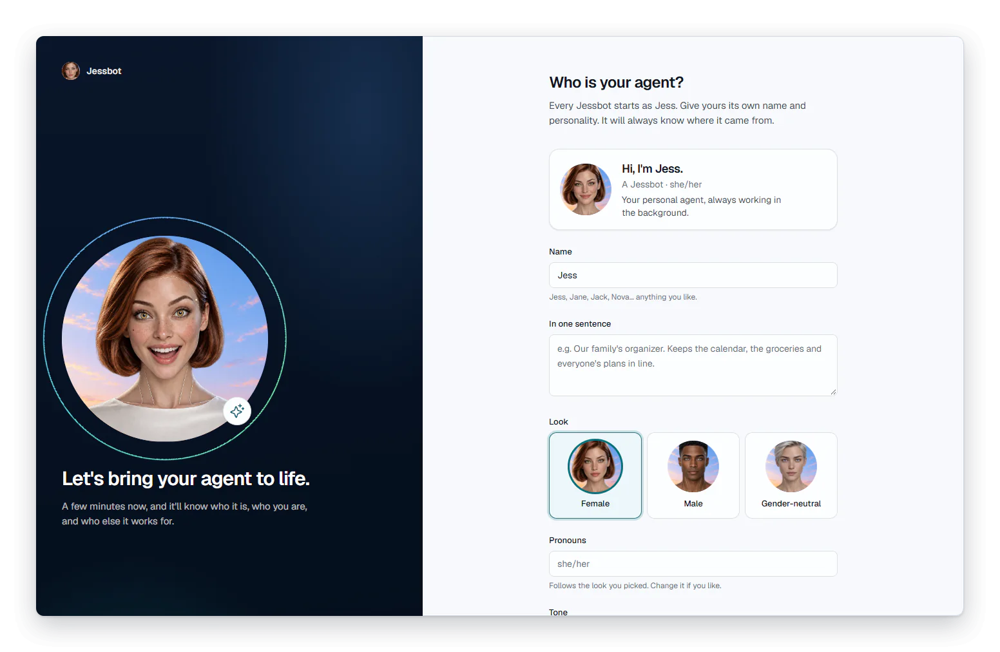

# Name and look

Every Jessbot starts as Jess, but yours can have its own name, pronouns, face and manner. This page covers what you
choose during setup, how to change it later in Admin → Identity, how to use your own pictures, and the living avatar
that changes with the time of day and the weather where you live. In the rest of this guide "Jess" means the assistant
under whatever name you give it.

## What you choose

You pick these in the fourth setup step, **Identity**, and the preview card at the top shows the result as you type:

- **Name**: anything up to 24 characters (Jess, Jane, Jack, Nova). A renamed assistant still knows where it came from:
  the preview reads "A Jessbot, originally Jess".
- **In one sentence**: a short description of what it is for, up to 160 characters. For example: "Our family's
  organizer. Keeps the calendar, the groceries and everyone's plans in line."
- **Look**: **Female**, **Male** or **Gender-neutral**, each a full set of portraits with their own expressions.
- **Pronouns**: these follow the look (she/her, he/him, they/them), and you can type others.
- **Tone**: **Warm & playful**, **Calm & professional**, **Concise & direct** or **Cheerful & encouraging**.

The name is used everywhere the interface talks about the assistant. The pronouns go into the personality file the
model reads; the interface's own text names the assistant instead of guessing a pronoun.

## Changing it later

Admins can change all of this in **Admin → Identity** and press **Save identity**. Saving rewrites only the identity
part of the assistant's personality file (`data/workspace/SOUL.md`); anything you wrote in the rest of that file in
Admin → Personality is kept.

The look also picks the default voice: in Admin → Models, a voice set to **Auto** matches the look and follows it when
you change it. You can also pick a voice of your own there.

## Your own pictures

Below the identity form, **Pictures** lets an admin change three pictures that everyone sees:

- **Avatar**: the assistant's face. By default it is the portrait set of the look you picked. **Upload a picture** to
  use your own, and **Use the portrait again** to go back. An uploaded avatar is one still picture: it shows for every
  expression, and the look you picked still sets the voice.
- **Background**: what sits behind the avatar, everywhere it appears.
- **Cover**: the band at the top of the chat and the greeting at the top of the Feed.

For the background and the cover you can choose **The live sky** (time of day and weather, the default), **Always** one
of the built-in scenes (such as "Dusk, rain" or "Night, clear"), or upload a picture of your own. Press **Save** after
picking a sky or a scene; an upload is applied as soon as it finishes.

What uploads accept:

- PNG, JPEG, WebP or GIF, up to 10 MB and 40 megapixels, and at least 64 pixels on each side. SVG isn't accepted.
- The avatar and background are cropped to a centred square. The cover keeps its shape, up to 1920 pixels wide.
- A GIF keeps only its first frame, and a phone photo comes out the right way up.
- Every upload is saved again as a new image, so what a photo hides (where and when it was taken, the camera) is left
  behind.

Uploaded pictures are only shown to people who are signed in. The sign-in and invite pages keep the built-in look.
Daily backups include them.

## The living avatar

With a built-in look, the assistant is never a frozen picture. The portrait breathes, blinks and glances around, looks
like it is listening while you type, and changes expression with what it is doing: thoughtful while it thinks, curious
while it searches, reading, focused while it writes or fills in a form, proud for a moment when something is done,
apologetic after an error, sleepy when it is offline. Changes fade from one expression to the next. If your device asks
for reduced motion, it only fades gently when its state changes.

## The sky behind it

The live sky follows the real moment where you live. Time of day comes from the actual sunrise and sunset at your home
(dawn and dusk are the 45 minutes either side), and the weather picks one of six skies: clear, cloudy, fog, rain, snow
or a storm. That makes 24 scenes, and the sky updates on its own as the day and the weather change.

Each person sees the sky over their own home. Set where you live in **You → Places** ("Where you live"); until then the
sky follows your clock with clear weather. Weather needs the agent's browser to be installed.

A background pinned to one scene stays as it is, while a cover set to the live sky still follows the time and weather.

Related: [Guide index](README.md) · [Getting started](getting-started.md) · [Models and costs](providers.md) ·
[People and admin](people-and-admin.md) · [Backups and updates](backups-and-updates.md) · [FAQ](faq.md)
