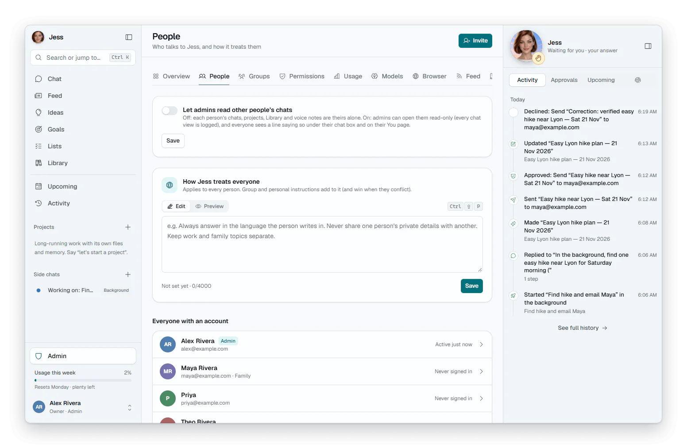
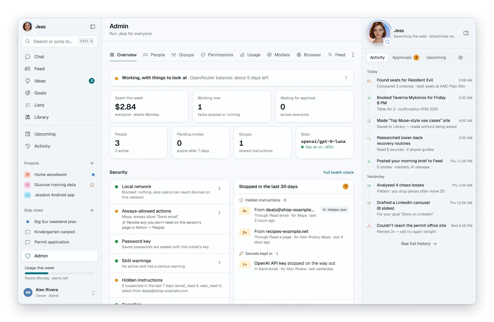

# People and admin

Jessbot is made for several people at once. You invite the others in your household, each of them gets their own
private chat with the assistant, and you, as the admin, decide what it may do for each person and how it treats them.
This page covers inviting people, what stays private, what admins control, signing in safely, and the rest of the Admin
pages.

## Inviting people

Go to **Admin → People** and press **Invite**. Fill in a name, an email if you like, a **Role** and a **Group**, then
press **Create link**. You can also do this in the last step of the setup wizard.

Send the link to the person however you like (a message, an email, a note on the fridge). It works once and for 7
days. They open it, choose their own name, email and password (at least 10 characters), and press **Join**. Unused
links are listed under **Pending invites** on the People page, where **Revoke** cancels one.

There are two roles:

- **Member**: has their own chat, Library, lists, goals, feed and settings, and no Admin pages.
- **Admin**: everything a member has, plus the Admin pages. Give it only to people who should manage the install.

If invite links come out as `localhost` addresses that don't work on other devices, see
[Troubleshooting](troubleshooting.md#invite-links-point-to-localhost).



## Each person's private chat

Everyone has their own main chat with the assistant, plus their own side chats, projects, Library, voice notes and
memories. What the assistant learns about one person stays with that person unless they choose to share it with a
group.

**Let admins read other people's chats**, at the top of Admin → People, is off for a new install. While it's off,
admins can't open anyone else's chats, projects, Library or voice notes. If you turn it on:

- admins can open them read-only, and can't change anything;
- every chat an admin opens is written to the audit log;
- everyone sees a line under their chat box ("Admins can read your chats here") and a notice on their You page, and the
  invite page tells new people before they join.

Talk it over with your household before you turn it on.

## Groups

Groups are for the people who belong together: a family, a team, the kids. Create one in **Admin → Groups** with
**Add group**, then add people to it from their page in Admin → People (**Groups**, then **Save groups**), or pick the
group when you invite them. A person can be in several groups.

Each group has its own instructions and its own permissions (open **Permissions for** the group). Lists can be shared
with a group, and a person can share a memory with a group they're in.

## What admins control

Settings stack in three layers: **Admin → Permissions** sets the defaults for everyone, a group can change them for its
members, and a person's own page can change them again. On a person's page, **Inherit** means "use what their groups
and the defaults say". If two of a person's groups disagree, the stricter one wins.

### How the assistant treats someone

Each layer has an instructions box: **How Jess treats everyone** on the People page, one per group, and
**How Jess treats** a person on their page (with your assistant's name instead of Jess). Write plain sentences about
tone, what to help with and what to avoid, for example "Theo is 12. Explain homework rather than giving answers. No
purchases." Group and personal instructions add to the ones for everyone, and win when they conflict. Only admins see
them, and they apply from the next message. A person's page keeps **Previous versions**.

### What it may do

Under **What Jess may do for** a person (and in the same form for groups and defaults), each kind of tool has
**Off**, **Ask first** or **Allowed**: Conversation basics, Memory, Web, Library, Schedules & alarms, Goals & ideas,
Email, Calendar, Files, Office documents, Projects, Lists and Pictures. Pictures is off for everyone until you turn it
on, because each picture costs money.

Whatever you choose, spending money or sending anything outside asks first, unless the person picked **Always allow**
on one of those approval cards. Those standing permissions are listed on the person's page with **Revoke**.

The same form has:

- **Who approves**: the person themself, or the admin (useful for children).
- **Weekly budget (USD)**: how much the assistant may spend on that person's behalf each week. When it runs out, new
  tasks stop until the week resets on Monday. Admin → Usage shows where it went.
- **One task, at most (USD)**: a single task that would spend more stops and asks first. 0 means no cap per task.
- **Quiet hours**: when the assistant doesn't message on its own.

Press **Save permissions**. Changes apply from the next message. More about approvals is in
[Approvals and safety](approvals-and-safety.md).

### Access

**Disable account** on a person's page signs them out everywhere and stops them signing in; **Re-enable account**
undoes it. The page also lists their **Signed-in devices**.

## Signing in safely

Everyone can manage their own sign-in in **You → Sign-in & devices**:

- **Change password**. This signs you out on every other device.
- **Two-step sign-in**. Enter your password and press **Set up**, scan the QR code with an authenticator app (Aegis,
  2FAS, Google Authenticator, 1Password and others), type the 6-digit code and press **Turn on**. You then get recovery
  codes, shown once: keep them somewhere safe, each works once if you lose your phone.
- **Devices & app tokens**: where you're signed in, with **Sign out** for each.

When someone forgets their password, an admin opens **Admin → People**, picks the person, and under **Signing in**
presses **Make a password reset link**. Hand the link over in person or by message. It works once, for 24 hours, and
setting the new password signs that person out everywhere. If they also lost their phone and their recovery codes,
**Turn off two-step sign-in** is on the same card.

If you are the admin and you're the one locked out, run this on the server (with the email you sign in with):

```bash
npm run reset-link -- alex@example.com
npm run reset-link -- alex@example.com --2fa-off   # also turns off two-step sign-in
```

It prints a one-time link and never writes it to the log.

## The other Admin pages



- **Overview**: a health summary, what was spent this week, what's running or waiting for approval, people, invites,
  groups, the model in use, security checks and recent admin activity.
- **People** and **Groups**: described above.
- **Permissions**: the defaults for everyone, and a table of every action the assistant can take with its risk
  (Reads, Changes, Spends, Sends out).
- **Usage**: the last 30 days, each person this week, what the money went to, by model, and the costliest tasks.
- **Models**: the API key, the main model, fallback models, a cheaper background model, the voice, quick decisions
  and pictures. See [Models and costs](providers.md).
- **Browser**: which browser the assistant uses, its settings (including **Allow the local network**), and a place to
  try a search.
- **Feed**: every source the Feed reads, who follows it, and whether it answers. See [Your Feed](feed.md).
- **Skills**: know-how the assistant follows for kinds of tasks. Skills are only used once an admin approves them.
- **Personality**: the Soul, Rules and Shared notes files, and the household Lessons waiting for your review.
- **Identity**: the assistant's name, look, tone and pictures. See [Name and look](name-and-look.md).
- **System**: the full health check, backups, the live server log and details about the install. See
  [Backups and updates](backups-and-updates.md).

Related: [Guide index](README.md) · [Getting started](getting-started.md) ·
[Approvals and safety](approvals-and-safety.md) · [Models and costs](providers.md) · [Name and look](name-and-look.md) ·
[Backups and updates](backups-and-updates.md) · [Troubleshooting](troubleshooting.md) · [FAQ](faq.md)
