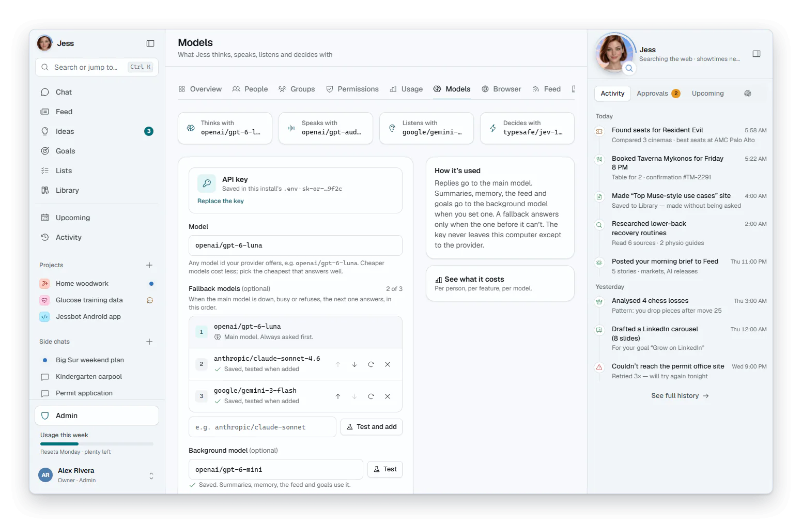

# Models and costs

Jessbot doesn't come with an AI model of its own: you bring one, and you pay the provider for what it uses. This page
explains which providers work, what each one can do, how to choose the models in Admin → Models, and how weekly budgets
keep the bill where you want it.

## OpenRouter, the default

Out of the box Jessbot talks to [OpenRouter](https://openrouter.ai), a service that offers many models behind one key.
You paste the key on the setup page (or put it in `.env` as `OPENROUTER_KEY`), and Jessbot keeps it on this machine,
encrypted with the install's own key; a key written in `.env` moves there the next time Jessbot starts. A key set in
the server's environment (Docker's `environment:`, systemd) is used as it is and never stored. The default model is `openai/gpt-6-luna`, a cheap, capable one picked for everyday
household use.

## Ollama: models on your own computer

[Ollama](https://ollama.com) runs models on your computer or another one on your network: free, private (nothing leaves
your network), and slower. On the setup page or in Admin → Models pick **Ollama**: the address fills in
(`http://127.0.0.1:11434/v1`; with Jessbot in Docker and Ollama on the computer, `http://host.docker.internal:11434/v1`),
no key is asked for, and the models Ollama has are listed. Pick one that can call tools and is **7B or larger**
(`ollama pull qwen2.5:7b`, `llama3.1:8b`): smaller ones connect but get lost in Jessbot's instructions. For memory
search by meaning, also `ollama pull nomic-embed-text`. A few features need OpenRouter and are off (below).

## Another OpenAI-compatible service

OpenAI itself, LM Studio, a LiteLLM or vLLM server: pick **Another OpenAI-compatible service**, enter its address
(usually ending in `/v1`), its key if it needs one, and the model's name as the service calls it. Before the first
setup you can also set `LLM_BASE_URL` (and `LLM_MODEL`) in `.env`: they fill in the setup page. Once setup or Admin →
Models has saved a provider, the saved one is used and those two lines are ignored, so change it in Admin → Models. A key you save is used only for the address you saved
it with: switching to another service asks for that service's key.

A model server on your own network works without opening the local network to the agent's browser: the address you
configure is allowed, and only that one.

## What works where

| Feature | OpenRouter | Ollama | Another OpenAI-compatible service |
|---|---|---|---|
| Chat, tools, tasks, goals, the feed, projects | Yes | With a model that calls tools, 7B or larger | Yes, with a model that calls tools |
| Memory search by meaning | Yes | With `nomic-embed-text` pulled | If it serves an embedding model; otherwise by keywords |
| Fallback models | Yes | No: the main model only | No: the main model only |
| Quick decisions | Yes | Off: the full model or plain rules decide | Off |
| Voice notes (speaking and listening) | Yes | Off: text only | Off |
| Making pictures | Yes | Off | Off |
| Reading scans and photos of text | Yes | Off | Off |
| Spending caps in dollars | Yes | Free, nothing to count | The service doesn't report costs, so budgets can't count spending |
| Low-balance warning | Yes | n/a | Off |

Admin → Models marks each feature that is off with your provider, and keeps its settings for when you switch back.

## Admin → Models

The tiles at the top say what the assistant **Thinks with**, **Speaks with**, **Listens with** and **Decides with**.
Below them:

- **Model**: the main model. Every reply goes to it first. Any model id your provider offers works; the cheapest one
  that answers well is usually the right choice.
- **Fallback models** (optional, up to 3): when the main model is down, busy or refuses, the next one answers, in the
  order you set. Each one answers a tiny test before it is added (**Test and add**). Only OpenRouter takes a
  fallback order; with other providers the main model answers alone. Admin → Usage shows how often a fallback answered.
- **Background model** (optional): a cheaper model for summaries, memory, the feed and goals. If it fails or answers
  badly, the main model tries once. Leave it empty and the main model does this work too.
- **Save and test** saves your changes and checks that the model answers.

Further down the same page:

- **Jess's voice** (titled with your assistant's name): which voice it speaks with (Auto follows its look) and the
  models for speaking and for transcribing your voice notes. Spoken replies need OpenRouter.
- **Quick decisions**: a small decision model answers narrow questions in about a third of a second, so the assistant
  skips work that isn't needed and moves faster in its browser. You can switch each use on or off,
  choose how sure it must be before it acts, and try it with **Try a decision**. It can only add checks, never skip
  one. It needs an OpenRouter key and endpoint; without them everything is decided the usual way.
- **Pictures**: an image model for invitations, colouring pages and story art. It stays off until you enter an image
  model id, and then only people with the **Pictures** permission can use it (off for everyone until you turn it on in
  Admin → Permissions, Groups or People). Saving checks the id with the provider and shows what a picture costs,
  without making one. Each picture counts against that person's weekly budget.

## Budgets and spending limits

Every person has a **weekly budget** in US dollars: $2 a week unless you change it. The week resets on Monday. Set it
for everyone in Admin → Permissions, or for a group or one person in Admin → Groups and Admin → People (leave
"Inherit" to follow the level above). A budget of 0 means no limit.

Next to it, **One task, at most (USD)** caps a single task: a task that would spend more stops and asks first. By
default the cap is $0.50 or a quarter of the weekly budget, whichever is lower; 0 means no cap per task.

What happens as a budget fills:

- each person gets a notification at 75 %, 90 % and 100 % of their week;
- once it is reached, new tasks and background work wait until Monday;
- the admin is alerted on a day that costs far more than usual, or when the provider keeps failing.

Everyone sees their own spending in You → Usage and in the "Usage this week" bar in the sidebar.

## Admin → Usage

Admin → Usage shows this week's and the last 30 days' spending, a chart by day, each person's spend against their
budget, what the money went to, which models it went to, and the costliest tasks. With an OpenRouter key it also reads
your **OpenRouter balance** every few hours, estimates how many days it will last at this pace, and warns when that is
under a week. Press the arrow on the balance card to read it now.

Related: [Guide index](README.md) · [Getting started](getting-started.md) ·
[Approvals and safety](approvals-and-safety.md) · [People and admin](people-and-admin.md) · [FAQ](faq.md) ·
[Troubleshooting](troubleshooting.md)
